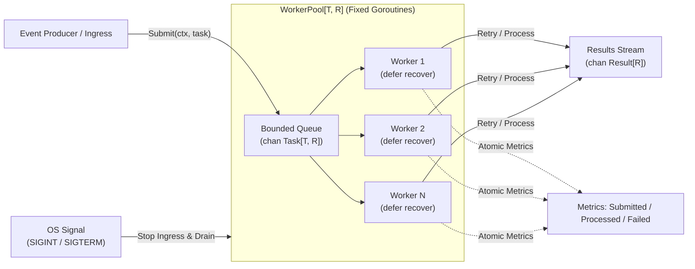
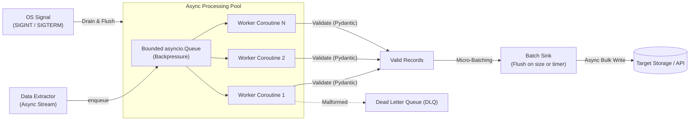

# Day 7: Capstone Project — Production-Grade Concurrency & Resilience

Welcome to the capstone of the Senior Polyglot Crash Course. This capstone unifies the concepts learned across Days 1 through 6 into two production-grade, fault-tolerant concurrent systems.

---

## 🎯 The Senior Polyglot Mental Model: Resilience & Concurrency

Senior engineers transitioning from the JVM (Java/Kotlin/Scala) or .NET (C#) to Go and Python encounter two drastically different approaches to concurrency, backpressure, and fault tolerance:

```text
       Enterprise Java / C#                          Idiomatic Go                             Modern Python
┌─────────────────────────────────┐       ┌─────────────────────────────────┐       ┌─────────────────────────────────┐
│ ThreadPoolExecutor              │       │ Goroutine Worker Pool           │       │ Async Event Loop (asyncio)      │
│ • OS-level kernel threads       │       │ • M:N user-space scheduler      │       │ • Single-threaded cooperative   │
│ • BlockingQueue backpressure    │       │ • Bounded buffered channels     │       │ • asyncio.Queue backpressure    │
│ • Thread.interrupt() flags      │       │ • context.Context propagation   │       │ • asyncio.Task cancellation     │
│ • UncaughtExceptionHandler      │       │ • defer / recover() per worker  │       │ • TaskGroup / ExceptionGroup    │
└─────────────────────────────────┘       └─────────────────────────────────┘       └─────────────────────────────────┘
```

### Architectural Comparison Matrix

| Dimension | Enterprise Java (ThreadPoolExecutor) | Idiomatic Go (CSP Worker Pool) | Modern Python (Async ETL Pipeline) |
| :--- | :--- | :--- | :--- |
| **Execution Model** | 1:1 kernel threads multiplexed by OS kernel. | M:N scheduler (millions of goroutines multiplexed across $GOMAXPROCS$ OS threads). | Single-threaded cooperative event loop (`async`/`await`). |
| **Memory Footprint** | ~1 MB default thread stack; large pools consume gigabytes. | ~2 KB initial goroutine stack; dynamic growth. | ~2–8 KB per coroutine frame. Extremely lightweight for I/O. |
| **Backpressure** | `ArrayBlockingQueue` with rejection policies (`AbortPolicy`, `CallerRunsPolicy`). | Bounded buffered channels with `select` default or context timeout. | Bounded `asyncio.Queue(maxsize=...)` with `await queue.put()` backpressure. |
| **Cancellation** | `Thread.interrupt()` requiring cooperative polling or `InterruptedException`. | `context.Context` cancellation tree checked via `select` on `ctx.Done()`. | `Task.cancel()` raising `asyncio.CancelledError` at the current `await` point. |
| **Failure Containment** | `Thread.UncaughtExceptionHandler`; unhandled exceptions kill the thread. | Worker `defer recover()` prevents unhandled panic from terminating the entire runtime process. | Task exception logged or stored; does not crash other concurrent tasks unless propagated. |
| **Graceful Shutdown** | `executor.shutdown()` + `awaitTermination(timeout, TimeUnit.SECONDS)`. | Signal trapping (`SIGINT`/`SIGTERM`) -> cancel root context -> drain work -> `sync.WaitGroup.Wait()`. | Signal trapping -> cancel producer -> drain queue -> flush batch sinks -> await task group. |

---

## 🏗️ System Architectures

### 1. Go: High-Throughput Concurrent Worker Pool (`go/`)

The Go capstone implements a generic, thread-safe, resilient worker pool designed for continuous stream processing (e.g., event enrichment or payment transaction ingestion).



#### Key Highlights:
- **Type-Parameterized Generics**: `WorkerPool[T any, R any]` providing compile-time type safety for task and result payloads.
- **Bounded Ingress & Backpressure**: Configurable channel buffer depth preventing out-of-memory errors under ingress surges.
- **Panic Resilience**: Worker-level panic recovery intercepts rogue task panics, logs the stack trace, and increments failure metrics without crashing the host process.
- **Exponential Backoff with Jitter**: Transient errors are retried with randomized jitter to prevent the "thundering herd" problem against downstream dependencies.
- **Zero-Allocation Metrics**: Monotonically increasing atomic operations (`sync/atomic`) for lock-free telemetry.
- **Graceful Shutdown**: Hard deadline coordination via `context.WithTimeout` ensuring in-flight tasks finish while rejecting new ingress.

---

### 2. Python: Asynchronous Streaming ETL Pipeline (`python/`)

The Python capstone implements an asynchronous, multi-stage ETL pipeline designed for high-concurrency I/O pipelines (e.g., webhook processing, API telemetry aggregation, or ingestion services).



#### Key Highlights:
- **Schema Validation & Coercion**: Pydantic v2 data models with custom validators, format normalizers, and a zero-dependency standard-library fallback.
- **Async Flow Control & Backpressure**: Bounded `asyncio.Queue` enforces producer backpressure; fast producers naturally yield when the queue reaches capacity.
- **Dead-Letter Queue (DLQ)**: Poison pills and permanent validation failures are routed to an isolated dead-letter queue with rich error diagnostics, preventing pipeline stalls.
- **Micro-Batching Sink**: Aggregates processed records into bulk payloads based on batch size or time interval thresholds (reducing downstream I/O overhead).
- **Asynchronous Graceful Shutdown**: Hooks into UNIX signals (`SIGINT`, `SIGTERM`), halts ingestion, drains queued items, and flushes partial micro-batches before completing cleanly.

---

## 📂 Project Organization

```text
day-07-capstone/
├── README.md                      # This overview & architecture guide
├── go/
│   ├── go.mod                     # Module definition
│   ├── README.md                  # Go implementation deep dive & benchmarks
│   ├── pool.go                    # Generic WorkerPool[T, R] implementation
│   ├── pipeline.go                # Domain models, retry with jitter, processor
│   ├── main.go                    # Live streaming CLI with graceful signal shutdown
│   └── pool_test.go               # Table tests, race detector (-race), panic tests, benchmarks
└── python/
    ├── pyproject.toml             # Python project configuration
    ├── README.md                  # Python implementation deep dive & patterns
    ├── models.py                  # Pydantic schema validation (with zero-dep fallback)
    ├── pipeline.py                # Async ETL pipeline, worker pool, DLQ, batch sink
    ├── main.py                    # Live streaming CLI with signal-driven shutdown
    ├── test_pipeline.py           # Async test suite (validation, retry, DLQ, shutdown)
    └── run_all.py                 # Dual-mode test runner (stdlib or pytest)
```

---

## 🚀 Quick Execution Guide

### Go Track
```bash
cd day-07-capstone/go

# 1. Run unit, panic recovery, and table-driven tests
go test -v ./...

# 2. Run race condition detection under concurrent load
go test -race -v -run TestWorkerPool_DataRace ./...

# 3. Run microbenchmarks with memory allocation profiling
go test -bench=. -benchmem -run=^$ ./...

# 4. Run the production demo (press Ctrl+C to test graceful shutdown)
go run main.go
```

### Python Track
```bash
cd day-07-capstone/python

# 1. Run the test suite (dual-mode: works with pytest or pure stdlib)
python3 run_all.py

# 2. Run with pytest (if pytest is installed in your environment)
pytest -v

# 3. Run the live async streaming ETL pipeline (press Ctrl+C to test graceful shutdown)
python3 main.py
```
