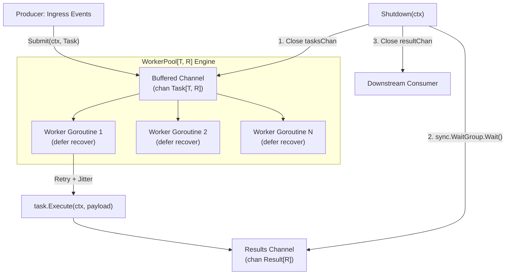

# Day 7 (Go Track): High-Throughput Concurrent Worker Pool

This capstone project implements a production-grade, generic concurrent worker pool in Go 1.27. It translates the enterprise Java `ThreadPoolExecutor` and C# `TaskScheduler` paradigms into idiomatic Go CSP (Communicating Sequential Processes) primitives.

---

## 🎯 The Senior JVM / .NET Mental Model Shift

In enterprise Java (`java.util.concurrent.ThreadPoolExecutor`) or C# (`System.Threading.Channels`):
- **Threads are heavy:** Backed by 1:1 kernel threads (~1 MB stack overhead). Spawning 10,000 OS threads will trigger `OutOfMemoryError` or severe CPU thrashing.
- **Queue Saturation Policies:** When a `BlockingQueue` fills, developers choose `AbortPolicy` (throws exception), `CallerRunsPolicy` (caller executes on its own thread), or `DiscardPolicy`.
- **Cancellation:** In Java, cancellation relies on setting a thread's interrupt status (`Thread.interrupt()`). Code must explicitly poll `Thread.interrupted()` or catch `InterruptedException`.
- **Unhandled Exceptions:** If an unhandled exception bubbles out of a worker thread, `Thread.UncaughtExceptionHandler` is invoked, and the thread dies (requiring the pool to spawn a replacement thread).

In **Go 1.27**:
- **Goroutines are extremely light:** User-space scheduled (M:N), initial stack size ~2 KB. Spawning tens of thousands of goroutines is routine.
- **CSP Channels as Bounded Queues:** Bounded channels (`make(chan Task, capacity)`) enforce backpressure natively. Senders block cooperatively without OS thread blocking syscalls.
- **`context.Context` Propagation:** Cancellation signals flow down a tree via channel closes (`<-ctx.Done()`), checked cleanly inside `select` blocks.
- **Panics terminate the entire process:** An unrecovered panic in ANY goroutine crashes the entire Go runtime process. Recovering via `defer recover()` inside each worker goroutine is the **only** boundary protecting the application.

---

## 🏗️ Architecture & Component Design



### 1. Generic Parameterization (`pool.go`)
The pool is defined as `WorkerPool[T any, R any]`, accepting any task payload `T` and producing any result type `R`. This provides compile-time type safety with zero interface boxing overhead.

### 2. Lock-Free Atomic Telemetry
Instead of acquiring mutexes on hot paths, metrics (`Submitted`, `Processed`, `Failed`, `Retried`, `Panics`, `ActiveWorkers`) use Go 1.19+ `sync/atomic` typed primitives (`atomic.Uint64`, `atomic.Int32`).

### 3. Worker Panic Isolation
```go
func (p *WorkerPool[T, R]) executeWithRecovery(task Task[T, R]) {
    defer func() {
        if r := recover(); r != nil {
            p.panics.Add(1)
            p.failed.Add(1)
            err = fmt.Errorf("%w: %v\nstack:\n%s", ErrTaskPanicked, r, debug.Stack())
        }
    }()
    // ... execution & retry
}
```
If a user task attempts a nil pointer dereference or slice index out-of-bounds, the panic is intercepted at the worker boundary, recorded in the result payload, and the worker goroutine remains alive to process subsequent work.

### 4. Exponential Backoff with Full Jitter
To mitigate thundering herd problems against upstream APIs or databases:
$$\text{Backoff} = \text{Random}(0, \min(\text{MaxBackoff}, \text{InitialBackoff} \times 2^{\text{attempt}-1}))$$

### 5. Coordinated Graceful Shutdown
1. `p.closeOnce.Do(...)`: Sets `isClosed = true` and closes `tasksChan`.
2. Active workers finish in-flight tasks and drain pending items from `tasksChan`.
3. `p.wg.Wait()` signals when all workers have completed.
4. If the graceful shutdown timeout context expires before workers finish, `p.cancel()` cancels the root context, aborting lingering tasks.
5. `resultChan` is closed once all workers have cleanly exited.

---

## ⚡ Benchmarks & Performance

Running microbenchmarks on Apple Silicon (M-series):
```bash
go test -bench=. -benchmem -run=^$ ./...
```

```text
goos: darwin
goarch: arm64
BenchmarkWorkerPool_Throughput-10    	 3696139	       323.4 ns/op	       0 B/op	       0 allocs/op
```

- **Throughput:** ~3.7 million tasks submitted and processed per second.
- **Heap Allocations:** **0 B/op, 0 allocs/op** on the hot submission loop.

---

## 🚀 How to Run

```bash
# 1. Run unit, table, and panic tests
go test -v ./...

# 2. Run data race verification under high concurrent load
go test -race -v ./...

# 3. Run microbenchmark with memory allocation stats
go test -bench=. -benchmem -run=^$ ./...

# 4. Run production CLI simulation
go run .
```
