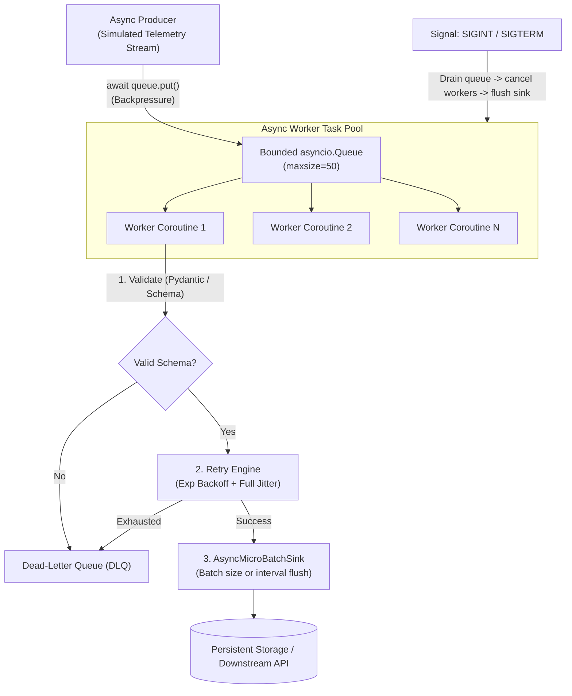

# Day 7 (Python Track): Streaming Async ETL Pipeline & Resilient Client

This capstone project implements a production-grade, asynchronous streaming ETL pipeline in Python. It translates the enterprise Java reactive streams (Project Reactor / RxJava) or C# `IAsyncEnumerable` / TPL Dataflow paradigms into modern idiomatic `asyncio`.

---

## 🎯 The Senior JVM / .NET Mental Model Shift

In enterprise Java (Reactive Streams, Spring WebFlux, Project Reactor) or C# (TPL Dataflow):
- **Reactive Streams Complexity:** Java developers often manage complex Publisher/Subscriber state machines (`Flux`, `Mono`, `Schedulers.boundedElastic()`), handling `BackpressureStrategy.BUFFER` vs `DROP`.
- **Thread Context Leaks:** Thread-local context (e.g. `SecurityContextHolder`, MDC logging) easily leaks or gets lost when operators hop across reactive thread pools.
- **Checked vs Unchecked Exceptions in Streams:** Exceptions inside functional stream operators (`.map()`, `.flatMap()`) terminate the pipeline unless explicitly wrapped in `Mono.onErrorResume()` or `Try<T>`.

In **Modern Python (3.9+)**:
- **Cooperative Single-Threaded Event Loop:** `async`/`await` coroutines execute on a single thread. There are no kernel context switches or thread safety race conditions on shared memory within the event loop, though coroutine scheduling interleaving still requires synchronization primitives (`asyncio.Lock`, `asyncio.Queue`).
- **Native Backpressure via `asyncio.Queue`:** Bounded queues (`asyncio.Queue(maxsize=N)`) handle flow control naturally:
  - If downstream workers are slow, `await queue.put()` cooperatively pauses the upstream producer without blocking the event loop.
  - No threads sleep; the event loop simply continues running other available coroutines.
- **Exception Containment:** An unhandled exception inside a detached `asyncio.Task` does not crash the entire process; it logs a warning unless retrieved. However, in structured concurrency (`asyncio.TaskGroup` in 3.11+), any uncaught exception cancels sibling tasks in the group.
- **Dead-Letter Queues (DLQ) for Data Pipelines:** Rather than crashing pipelines on bad records, resilient production architectures route malformed payloads (poison pills) to a dedicated DLQ while keeping throughput steady.

---

## 🏗️ Architecture & Component Design



### 1. Dual-Mode Schema Validation (`models.py`)
- Employs **Pydantic v2** (`BaseModel`, `@field_validator`) when installed in your environment.
- Automatically falls back to a **zero-dependency dataclass validator** if third-party packages are not installed, ensuring identical validation guarantees:
  - Strict string formatting (regex `dev-[a-zA-Z0-9_-]+`).
  - Allowed metric enumeration checks (`cpu_usage`, `temperature_c`, etc.).
  - Domain physical constraints (e.g. rejection of temperatures below $-273.15^\circ\text{C}$).

### 2. Flow Control with Bounded `asyncio.Queue` (`pipeline.py`)
```python
async def enqueue(self, raw_payload: Dict[str, Any], timeout: Optional[float] = 2.0) -> bool:
    try:
        await asyncio.wait_for(self.queue.put(raw_payload), timeout=timeout)
        self.metrics.extracted += 1
        return True
    except asyncio.TimeoutError:
        return False  # Upstream throttled
```
If the downstream workers or sink are blocked, the queue reaches its `maxsize`, causing `queue.put()` to pause the producer coroutine, preventing unbounded memory spikes.

### 3. Fault Tolerance & Dead-Letter Queue (DLQ)
Records that fail validation or exhaust retries are never silently dropped. They are wrapped in `DeadLetterRecord` and stored in `pipeline.dlq` alongside:
- The exact failure stage (`"validation"`, `"enrichment_retry"`).
- The detailed error string and original payload.

### 4. Micro-Batching Sink (`AsyncMicroBatchSink`)
Instead of issuing individual I/O requests per event:
- Accumulates validated records in memory.
- Flushes immediately when `batch_size` (e.g., 15 items) is reached.
- Flushes periodically on `flush_interval_seconds` (e.g., 0.25s) if batch size hasn't been met, bounding delivery latency.

### 5. Coordinated Async Graceful Shutdown
1. Stop accepting new ingress payloads (`_is_running = False`).
2. Await `queue.join()` up to a configurable deadline to process all items currently in flight.
3. Cancel worker tasks and await completion via `asyncio.gather(*workers, return_exceptions=True)`.
4. Trigger `sink.stop()` to perform a final flush of partial micro-batches.

---

## 🚀 How to Run

```bash
cd day-07-capstone/python

# 1. Run the test suite (supports standalone execution or pytest)
python3 run_all.py

# 2. Run with pytest (if pytest is installed)
pytest -v

# 3. Run the live streaming simulation
python3 main.py
```
